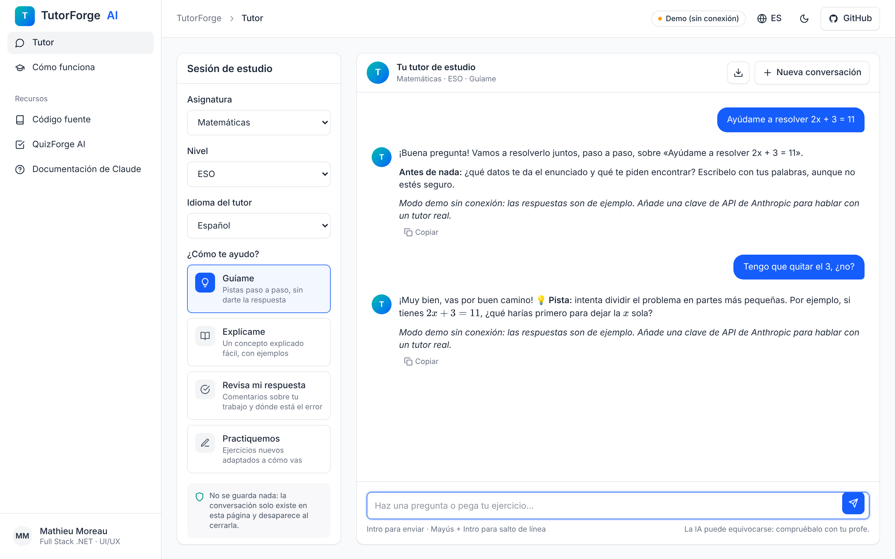
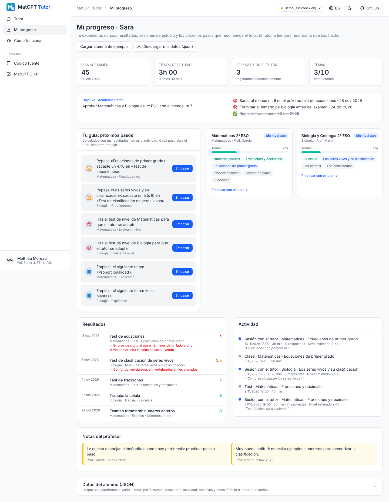
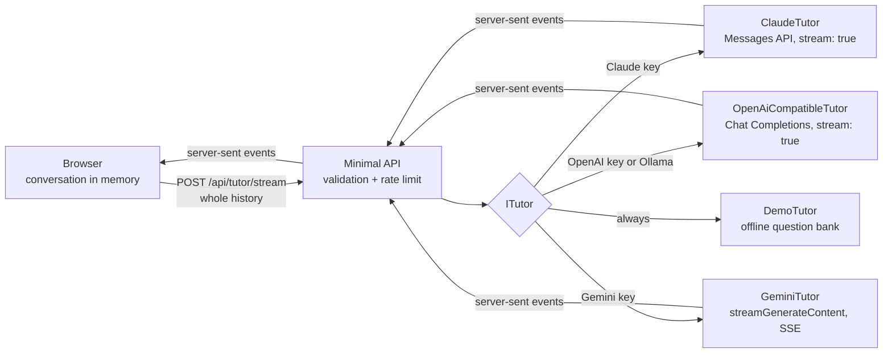

# MatGPT Tutor

**An AI study tutor that teaches instead of doing the homework.**
Students choose a subject, their level and how they want help: MatGPT Tutor guides them with questions and hints (Socratic method), explains concepts, checks their answers or gives them exercises to practise.

Built with **ASP.NET Core (.NET 10)**, your choice of AI (**Claude, ChatGPT, Gemini or a local Ollama model**, all streaming) and a dashboard UI made with **Tailwind CSS + Preline UI**. No account needed: progress is saved anonymously per subject.





<details>
<summary>Dark mode</summary>


</details>

## Features

- 💬 **Chat with streaming**: the answer appears word by word, with a Stop button
- 🎯 **Assess my level**: the tutor starts by itself with an adaptive test (questions get harder or easier with each answer), gives a 0-10 level report, then keeps training and updates the level as the student improves
- 🔘 **Answer buttons**: multiple-choice questions (A-D) appear as clickable cards with every engine, including the demo, and the level test can be restarted at the end of any conversation
- 🧭 **More teaching modes**: *Guide me* (hints, no direct answer), *Explain*, *Check my answer*, *Practise* (adaptive exercises)
- 📌 Optional topic (e.g. "linear equations") to focus the session
- 🎓 Subject (maths, sciences, history, languages, programming…) and level (primary to university)
- ➗ **Markdown and math** rendering: LaTeX formulas with KaTeX, sanitized with DOMPurify
- 🧠 **A tutor with memory**: every answer is logged in the student's record (sessions, topic, level before → after) and the AI receives a briefing of the student's courses, results, mistakes, last sessions and teacher notes, so it continues where the student left off
- 📈 **My progress**: study guide with the next steps (review weak results, continue topics, level tests, next topic, exam practice), level curve per subject, course topics, results with mistakes, activity, goals and teacher notes; each step opens the tutor ready to work
- 🗂️ **Student record in JSON**: view, edit, import and export the record (the data a school platform would provide); a sample student shows it all at once
- 💾 **Saved progress per subject**: conversation, settings and level history are restored when the student comes back or switches subject; changing to a new subject shows the welcome screen with the level test
- 🔒 **Privacy by design**: anonymous cookie (no name, no email), 90-day retention with automatic cleanup, "Delete my progress" button
- 🛡️ **Safe for young learners**: age-appropriate answers, never asks for personal data, encourages talking to a trusted adult if a student seems unwell
- 🗣️ Interface in **English, Français, Español and Català** (`.resx` localization); the tutor's language can be chosen separately
- 📥 Download the conversation as Markdown to keep your notes
- 🌗 Responsive layout with dark mode
- 🤖 **Choose your AI**: Claude, ChatGPT, Gemini or Ollama (free, local) from a selector in the header; each engine appears once its key is configured
- 🧪 **Offline demo mode**: works without an API key, with a multiple-choice question bank per subject and language (random order per session, answers checked) so anyone can try it

## How it works



Technical choices worth noting:

- **Hidden level tracking.** In Assess and Practice modes the model appends a hidden `[[LEVEL:n]]` tag; the UI strips it from the text and turns it into a level bar with a trend (▲ +1), without any database.
- **Pedagogy in the prompt.** `TutorPromptBuilder` builds a system prompt per mode (Socratic guidance, explanation structure, error-finding, adaptive practice) plus permanent safety rules. It's covered by tests.
- **Stateless chat, persistent progress.** The chat endpoint is stateless (the browser sends the history; `ConversationNormalizer` makes it valid for the API). Progress goes through `ProgressService` and the `IStudentProgressStore` repository: the demo writes atomic JSON files (`FileStudentProgressStore`), and [docs/database.sql](docs/database.sql) contains the SQL Server schema for a production implementation, without changing anything else.
- **Memory = data + rules + prompt.** `StudentRecord` is one JSON document per student (profile, enrollments with topics, assessments with mistakes, activity, goals, teacher notes) behind `IStudentRecordStore`, with the SQL schema in [docs/database.sql](docs/database.sql). `RecordRules.TrackTutorTurn` logs each answer (sessions merged within 30 minutes), `StudentContextBuilder` turns the record into a short briefing for the AI (injected server-side through a `[JsonIgnore]` property, so the browser cannot forge it) and `ProgressionAdvisor` computes the explainable next steps.
- **Anonymous identity.** A random id in an HttpOnly cookie identifies the student; with real authentication it simply becomes the user id. A background service purges inactive students after 90 days.
- **Pluggable AI engines.** `TutorEngines` is a registry of the configured providers; the header selector stores the choice in a cookie and the stream endpoint resolves it per request. One `OpenAiCompatibleTutor` covers ChatGPT and Ollama, and `GeminiTutor` uses Gemini's native API (works with the new `AQ.` keys), all with the same prompts as Claude.
- **End-to-end streaming.** Claude's SSE stream is parsed (`content_block_delta`) and re-emitted as SSE to the browser, which renders Markdown progressively. Cancelling in the UI aborts the request to the AI too.
- **Safe rendering.** Model output is Markdown converted with `marked` and sanitized with `DOMPurify` before touching the DOM; math is protected from the Markdown parser and rendered with KaTeX.
- **Cost protection.** Rate limiting (20 messages/minute per IP), message and conversation size limits.

## Project structure

```
src/
  TutorForge.Core/            Models, validation, prompts (pedagogy + safety), progress service, student record (rules, AI briefing, study guide, sample)
  TutorForge.Infrastructure/  JSON record store, Claude and OpenAI-compatible streaming tutors (HttpClient + SSE), engine registry, offline demo tutor, JSON progress store, cleanup job
  TutorForge.Web/             Razor Pages UI, streaming minimal API, localization, rate limiting
    Resources/                UI translations (en, fr, es, ca)
    Styles/                   Tailwind CSS source + vendor copy script
    wwwroot/                  Built CSS and JS (committed: no Node needed to run)
tests/
  TutorForge.Tests/           xUnit tests (validator, prompts, normalizer, SSE parsing, demo tutor)
```

## Getting started

Requirements: [.NET 10 SDK](https://dotnet.microsoft.com/download) or Docker.

```bash
git clone https://github.com/MathieuMoe/ai-study-tutor.git
cd ai-study-tutor
dotnet run --project src/TutorForge.Web
# open https://localhost:7190
```

The app starts in **demo mode**. Add one or more AI keys (stored with user-secrets, never in the repo); every configured engine appears in the header selector:

```bash
# Claude  - https://console.anthropic.com/
dotnet user-secrets set "Claude:ApiKey" "sk-ant-..." --project src/TutorForge.Web
# ChatGPT - https://platform.openai.com/api-keys
dotnet user-secrets set "OpenAI:ApiKey" "sk-..." --project src/TutorForge.Web
# Gemini (free tier available) - https://aistudio.google.com/apikey
dotnet user-secrets set "Gemini:ApiKey" "AQ...." --project src/TutorForge.Web
# Ollama (free, runs on your machine) - https://ollama.com, then: ollama pull llama3.2
dotnet user-secrets set "Ollama:Enabled" "true" --project src/TutorForge.Web
# Optional: engine selected by default
dotnet user-secrets set "Ai:Default" "gemini" --project src/TutorForge.Web
```

With Docker: `OPENAI_API_KEY=sk-... docker compose up --build` (or `ANTHROPIC_API_KEY`, `GEMINI_API_KEY`) and open http://localhost:8080.

| Setting | Default | Description |
|---|---|---|
| `Ai:Default` | first configured | Default engine: `claude`, `openai`, `gemini`, `ollama` or `demo`. |
| `Claude:ApiKey` / `ANTHROPIC_API_KEY` | – | Enables Claude. |
| `Claude:Model` | `claude-sonnet-4-5` | Any model from the [models list](https://docs.claude.com/en/docs/about-claude/models). |
| `Claude:MaxTokens` | `2048` | Maximum answer size. |
| `OpenAI:ApiKey` / `OPENAI_API_KEY` | – | Enables ChatGPT. `OpenAI:Model` defaults to `gpt-5-mini`. |
| `Gemini:ApiKey` / `GEMINI_API_KEY` | – | Enables Gemini. `Gemini:Model` defaults to `gemini-flash-latest`. |
| `Ollama:Enabled` | `false` | Enables a local Ollama model (`Ollama:Model`, `Ollama:BaseUrl`). |
| `Progress:Directory` | `App_Data/progress` | Where the demo progress store writes (excluded from git). |
| `Progress:Retention` | `90.00:00:00` | Inactive students are deleted after this time. |

## API

```bash
curl -N -X POST http://localhost:5190/api/tutor/stream \
  -H "Content-Type: application/json" \
  -d '{ "messages": [{ "role": "User", "content": "What is a fraction?" }],
        "subject": "Mathematics", "level": "Primary", "mode": "Explain", "language": "English" }'
```

Answers with `text/event-stream`: `data: {"text":"..."}` chunks, then `event: done` (or `event: error`).

Progress: `GET /api/progress` (all subjects), `PUT /api/progress/{subject}` (save one subject), `DELETE /api/progress` (forget me: progress and record).

Student record: `GET /api/record`, `PUT /api/record` (replace, sanitised), `POST /api/record/sample?language=Spanish` (demo student), `GET /api/record/export` (record + progress as one JSON file), `DELETE /api/record`.

## Front-end (optional)

```bash
cd src/TutorForge.Web
npm install
npm run build        # copies Preline, marked, DOMPurify and KaTeX to wwwroot/lib and builds the CSS
```

## Tests

```bash
dotnet test
```

## Roadmap

- [x] Choose between Claude, ChatGPT, Gemini and Ollama
- [ ] Attach a photo or PDF of the exercise
- [x] Student record with memory, study guide and JSON import/export
- [ ] SQL Server implementation of `IStudentProgressStore` and `IStudentRecordStore` (schema ready in docs/database.sql)
- [ ] Connector to a school platform (courses, grades and activity feed the record automatically)
- [ ] Teacher view: choose topics and see anonymous difficulty statistics
- [ ] Voice input for younger students

## Credits

[Preline UI](https://preline.co/) and [Tailwind CSS](https://tailwindcss.com/) (MIT), [marked](https://marked.js.org/) (MIT), [DOMPurify](https://github.com/cure53/DOMPurify) (Apache 2.0 / MPL 2.0), [KaTeX](https://katex.org/) (MIT).

## Author

**Mathieu Moreau**, Full Stack .NET Developer & UI/UX Designer
[LinkedIn](https://www.linkedin.com/in/mathieu-moreau-045b26114/) · [GitHub](https://github.com/MathieuMoe) · see also [MatGPT Quiz](https://github.com/MathieuMoe/ai-quiz-generator)

Licensed under the [MIT License](LICENSE).
