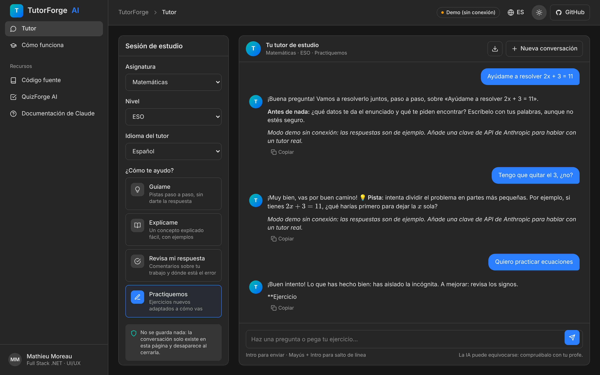
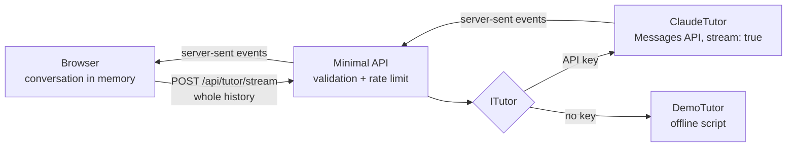

# TutorForge AI

**An AI study tutor that teaches instead of doing the homework.**
Students choose a subject, their level and how they want help: TutorForge guides them with questions and hints (Socratic method), explains concepts, checks their answers or gives them exercises to practise.

Built with **ASP.NET Core (.NET 10)**, the **Claude API** (streaming) and a dashboard UI made with **Tailwind CSS + Preline UI**. No account and no database: nothing is stored.


<details>
<summary>Dark mode</summary>



</details>

## Features

- 💬 **Chat with streaming**: the answer appears word by word, with a Stop button
- 🧭 **4 teaching modes**: *Guide me* (hints, no direct answer), *Explain*, *Check my answer*, *Practise* (adaptive exercises)
- 🎓 Subject (maths, sciences, history, languages, programming…) and level (primary to university)
- ➗ **Markdown and math** rendering: LaTeX formulas with KaTeX, sanitized with DOMPurify
- 🔒 **Privacy by design**: the conversation only lives in the browser page; the server is stateless and keeps nothing
- 🛡️ **Safe for young learners**: age-appropriate answers, never asks for personal data, encourages talking to a trusted adult if a student seems unwell
- 🗣️ Interface in **English, Français, Español and Català** (`.resx` localization); the tutor's language can be chosen separately
- 📥 Download the conversation as Markdown to keep your notes
- 🌗 Responsive layout with dark mode
- 🧪 **Offline demo mode**: works without an API key (scripted tutor) so anyone can try it

## How it works



Technical choices worth noting:

- **Pedagogy in the prompt.** `TutorPromptBuilder` builds a system prompt per mode (Socratic guidance, explanation structure, error-finding, adaptive practice) plus permanent safety rules. It's covered by tests.
- **Stateless server.** The browser sends the whole conversation each turn; `ConversationNormalizer` makes it valid for the API (starts with the student, alternating roles). No session, no database, no personal data.
- **End-to-end streaming.** Claude's SSE stream is parsed (`content_block_delta`) and re-emitted as SSE to the browser, which renders Markdown progressively. Cancelling in the UI aborts the request to the AI too.
- **Safe rendering.** Model output is Markdown converted with `marked` and sanitized with `DOMPurify` before touching the DOM; math is protected from the Markdown parser and rendered with KaTeX.
- **Cost protection.** Rate limiting (20 messages/minute per IP), message and conversation size limits.

## Project structure

```
src/
  TutorForge.Core/            Models, validation, prompts (pedagogy + safety), conversation normalizer
  TutorForge.Infrastructure/  Claude streaming tutor (HttpClient + SSE), offline demo tutor, DI
  TutorForge.Web/             Razor Pages UI, streaming minimal API, localization, rate limiting
    Resources/                UI translations (en, fr, es, ca)
    Styles/                   Tailwind CSS source + vendor copy script
    wwwroot/                  Built CSS and JS (committed: no Node needed to run)
tests/
  TutorForge.Tests/           xUnit tests (validator, prompts, normalizer, SSE parsing, demo tutor)
```

## Getting started

Requirements: [.NET 10 SDK](https://dotnet.microsoft.com/download) or Docker.

```bash
git clone https://github.com/MathieuMoe/ai-study-tutor.git
cd ai-study-tutor
dotnet run --project src/TutorForge.Web
# open https://localhost:7190
```

The app starts in **demo mode**. To use Claude, add your [Anthropic API key](https://console.anthropic.com/):

```bash
dotnet user-secrets set "Claude:ApiKey" "sk-ant-..." --project src/TutorForge.Web
```

With Docker: `ANTHROPIC_API_KEY=sk-ant-... docker compose up --build` and open http://localhost:8080.

| Setting | Default | Description |
|---|---|---|
| `Claude:ApiKey` / `ANTHROPIC_API_KEY` | – | Enables Claude. Without it, demo mode is used. |
| `Claude:Model` | `claude-sonnet-4-5` | Any model from the [models list](https://docs.claude.com/en/docs/about-claude/models). |
| `Claude:MaxTokens` | `2048` | Maximum answer size. |

## API

```bash
curl -N -X POST http://localhost:5190/api/tutor/stream \
  -H "Content-Type: application/json" \
  -d '{ "messages": [{ "role": "User", "content": "What is a fraction?" }],
        "subject": "Mathematics", "level": "Primary", "mode": "Explain", "language": "English" }'
```

Answers with `text/event-stream`: `data: {"text":"..."}` chunks, then `event: done` (or `event: error`).

## Front-end (optional)

```bash
cd src/TutorForge.Web
npm install
npm run build        # copies Preline, marked, DOMPurify and KaTeX to wwwroot/lib and builds the CSS
```

## Tests

```bash
dotnet test
```

## Roadmap

- [ ] Attach a photo or PDF of the exercise
- [ ] Teacher view: choose topics and see anonymous difficulty statistics
- [ ] Voice input for younger students

## Credits

[Preline UI](https://preline.co/) and [Tailwind CSS](https://tailwindcss.com/) (MIT), [marked](https://marked.js.org/) (MIT), [DOMPurify](https://github.com/cure53/DOMPurify) (Apache 2.0 / MPL 2.0), [KaTeX](https://katex.org/) (MIT).

## Author

**Mathieu Moreau**, Full Stack .NET Developer & UI/UX Designer
[LinkedIn](https://www.linkedin.com/in/mathieu-moreau-045b26114/) · [GitHub](https://github.com/MathieuMoe) · see also [QuizForge AI](https://github.com/MathieuMoe/ai-quiz-generator)

Licensed under the [MIT License](LICENSE).
